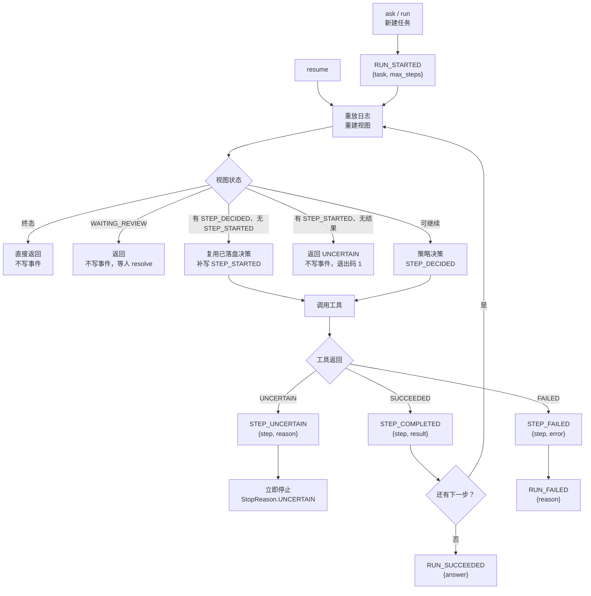
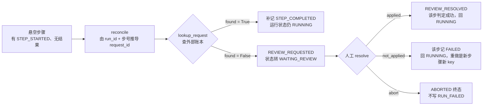
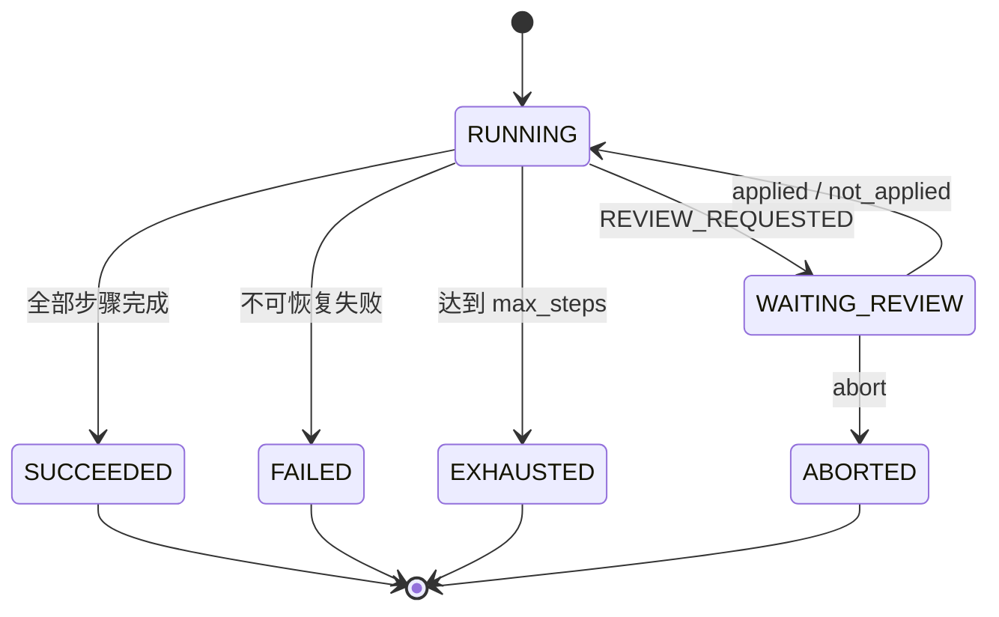

# 架构与流程

一页看懂：命令怎么进来、事件怎么写、崩溃后怎么走。文字版便于随代码更新，
与 `main` 分支的实现逐条对齐。

---

## 一、命令路由

| 命令 | 入口函数 | 做什么 | 写事件 |
|---|---|---|---|
| `ask "一句话"` | `cmd_ask` | 模型策略跑新任务，run_id 按时间生成 | 是 |
| `run --run-id` | `cmd_run` | 跑新任务，`--policy script\|model`；脚本模式必须给 `--script` | 是 |
| `resume --run-id` | `cmd_resume` | 重放后继续；遇悬空步骤则原地停下 | 分情况，见下 |
| `reconcile --run-id` | `cmd_reconcile` | 拿 `request_id` 查账本，查到补记、查不到提请复核 | 是 |
| `resolve --run-id --decision` | `cmd_resolve` | 写下人工结论，`applied` / `not_applied` / `abort`，`--note` 必填 | 是 |
| `status --run-id` | `cmd_status` | 打状态与剩余租约 | 否 |
| `trace --run-id` | `cmd_trace` | 时间线或导出 JSONL | 否 |
| `verify [--run-id]` | `cmd_verify` | 校验哈希链，报第一个断点 | 否 |
| `ledger init --A --B` | `cmd_ledger_init` | 初始化账本余额 | 否 |
| `ledger balance` | `cmd_ledger_balance` | 查余额，`--account` 可选 | 否 |

`ask` 与 `run` 的区别：前者固定模型策略、run_id 自动生成；后者两种策略都支持、
run_id 必须给。两者内部走同一条 `Engine.run`。

---

## 二、主循环与三条恢复路径

**resume 的写与不写**——它先重放（只读），随后按视图分支：

| 情形 | 是否写事件 |
|---|---|
| 已是终态 | 否 |
| 处于 `WAITING_REVIEW` | 否 |
| 最后一步只有 `STEP_DECIDED` | 是：补写 `STEP_STARTED` 并执行该工具 |
| 最后一步已开始、无结果 | 否：返回 `StopReason.UNCERTAIN`，退出码 1 |
| 其他 | 是：正常继续执行 |

所以“resume 只读”是错的，准确的说是**重放阶段只读，继续执行阶段照常写**。

---

## 三、悬空之后：对账与复核

三条约束，缺一不可：

1. `request_id` 可以**从日志推导**（`run_id + 步号`），所以原始返回值丢了也查得了账。
2. 查不到**不能**当成“没生效”，只能提请复核——`found=False` 不构成证据。
3. `applied` 只写 `REVIEW_RESOLVED`，不补 `STEP_COMPLETED`；结论由 `replay` 推出。

---

## 四、任务状态

`UNCERTAIN` **不是**任务状态，它是 worker 这次停下来的原因（`StopReason`）。
遇到它时循环停了，但任务仍停在 `RUNNING`——事实不足，既不成功也不失败。
`WAITING_REVIEW` 是暂停而不是终态，还能回到 `RUNNING`。

---

## 五、事件契约

| 事件 | payload | 含义 |
|---|---|---|
| `RUN_STARTED` | `{task, max_steps}` | 任务开始，仅新建时写一次 |
| `STEP_DECIDED` | `{step, tool, args}` | 策略给出这一步做什么 |
| `STEP_STARTED` | `{step, attempt}` | 即将碰外部世界；不含 request_id |
| `STEP_COMPLETED` | `{step, result}` | 工具确定成功；`result` 里带 `request_id` |
| `STEP_FAILED` | `{step, error}` | 工具确定失败 |
| `STEP_UNCERTAIN` | `{step, reason}` | 工具当场承认“不知道有没有生效” |
| `DECISION_FAILED` | `{reason, attempt}` | 模型调用失败，任务仍 `RUNNING` |
| `REVIEW_REQUESTED` | `{step, reason}` | 对账查不到，转人工；不含 request_id |
| `REVIEW_RESOLVED` | `{step, decision, note, result?}` | 人工结论；`note` 必填，`result` 仅 `applied` |
| `RUN_SUCCEEDED` | `{answer}` | 成功终态 |
| `RUN_FAILED` | `{reason}` | 失败终态 |
| `RUN_EXHAUSTED` | `{max_steps}` | 步数耗尽终态 |

三个结果事件的字段名刻意不同：`result` / `error` / `reason` 分别对应
“确定成功”“确定失败”“结果未知”三种确定性，混用会把这个区分抹平。

---

## 六、和代码的对应

| 图里的东西 | 代码位置 |
|---|---|
| 主循环、复用决策、UNCERTAIN 即停 | `src/agentrun/engine.py` 的 `_drive` / `_execute` |
| 事件形状与顺序校验 | `src/agentrun/model.py` 的 `apply` |
| 租约、epoch 栅栏、`expect_seq` | `src/agentrun/journal.py` 的 `append` / `acquire` |
| 对账与人工结论 | `src/agentrun/reconcile.py` 的 `reconcile` / `resolve_review` |
| 账本幂等（回执去重、转账不去重） | `src/agentrun/demo.py` 的 `save_receipt` / `transfer` |
| 命令注册与参数 | `src/agentrun/cli.py` |
